# Modernize to SQL PaaS

**Azure SQL Database with Key Vault and Managed Identity**

Replacing a self-managed database server with a managed database, and giving a web server access to the database password without storing that password on the server.

**Video walkthrough (5 min):** [Modernize to SQL PaaS on Loom](https://www.loom.com/share/b808c626ccc44ec2b4497085ea4515ab)

## The Business Problem This Lab Solves

Many small teams run their application database on a virtual machine they manage themselves. That puts two ongoing burdens on the team:

1. **Upkeep.** Someone has to patch the operating system and the database software, set up backups, and keep the server available. That is time not spent on the application.
2. **Password sprawl.** The web server needs the database password, so the password usually ends up in a config file or in code. Anyone who can read that file, or a repository it gets committed to, now has the database password.

This lab addresses both. The database moves to Azure SQL Database, a managed service where Microsoft runs the server. The password moves into Azure Key Vault, and the web server gets its own identity with read-only access to it.

**Scope of this lab:** it covers the infrastructure and access setup. No application data was migrated. I tested that the web server can read the secret and can open a network connection to the SQL server. I did not test the web server logging in to the database with the password. That is listed under next steps.

## How This Lab Solves It

| Business challenge | Solution in this lab | Proof |
|---|---|---|
| The team patches and backs up its own database server | Removed the database VM from the earlier lab and created an Azure SQL Database (`sqldb-app`) on a logical server (`sql-server-timothy`) | [Old resource group](screenshots/02-lab02-database-vm-removed.png) lists 7 resources and no database VM. [New resource group](screenshots/03-lab03-resource-group.png) lists the SQL server, database, and Key Vault. [SQL databases list](screenshots/04-sql-database-list.png) shows `sqldb-app` on `sql-server-timothy` |
| The database password sits in files people and servers can read | Stored the password as a Key Vault secret named `SqlAdminPassword`, in a vault that uses Azure role-based access control | [Secret](screenshots/06-key-vault-secret.png) shows as Enabled, with the value hidden |
| The web server needs the password, but giving it a stored credential recreates the problem | Turned on a system-assigned managed identity for `vm-web-01`, so Azure issues it short-lived tokens | [Identity page](screenshots/07-vm-managed-identity-on.png) shows Status On. Test 1 returned a token (length 1894), shown in the video |
| The web server should only have the access it needs | Assigned the VM's identity the Key Vault Secrets User role on that one vault | [Role assignment](screenshots/08-vm-key-vault-secrets-user-role.png). [Test 2](screenshots/10-test2-read-secret-200.png) (read) returned 200. [Test 3](screenshots/11-test3-write-blocked-403.png) (write) returned 403 |
| The web server has to be able to reach the new database | Checked the network path from `vm-web-01` to the SQL server on port 1433 | [Test 4](screenshots/12-test4-sql-port-1433-reachable.png) returned "Port 1433 reachable". A database login was not tested |

## Architecture

The database server from the earlier lab is gone. The database is now a managed service, and the web server uses its own identity to read the password from Key Vault.

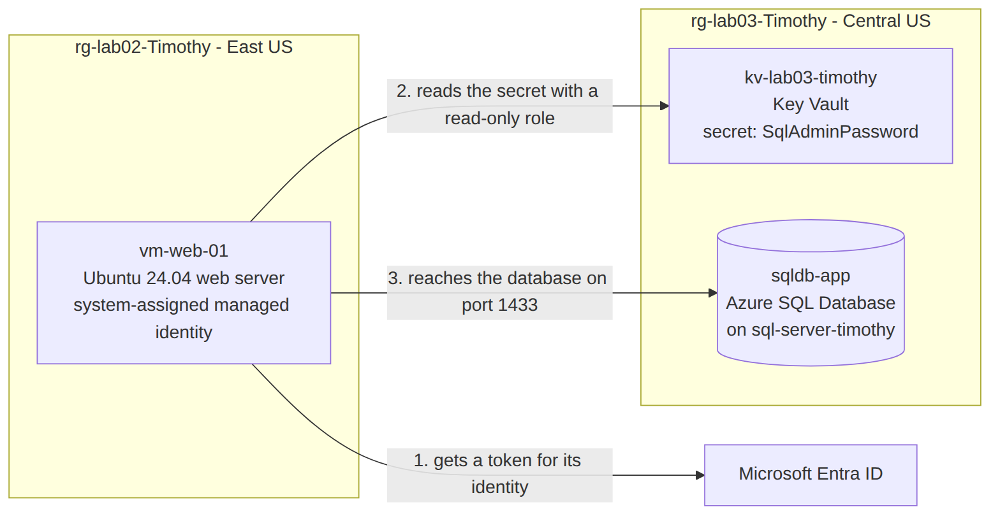

**Where it started.** The earlier lab ran the application on two servers in separate subnets: an app server and a database server.

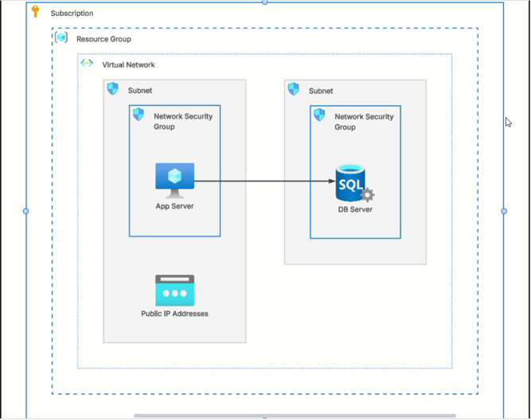

| Resource | Name | Region |
|---|---|---|
| Web server (from the earlier lab) | `vm-web-01` in `rg-lab02-Timothy` | East US |
| Azure SQL logical server | `sql-server-timothy` | Central US |
| Azure SQL Database | `sqldb-app` | Central US |
| Key Vault | `kv-lab03-timothy` | Central US |

Everything was built in the Azure portal.

## Build Walkthrough

### 1. Remove the self-managed database server

I deleted the database VM from the earlier lab along with its disk and network interface. Stopping the VM would not have been enough, because a stopped VM is still charged for its disk. The web server, `vm-web-01`, stayed.

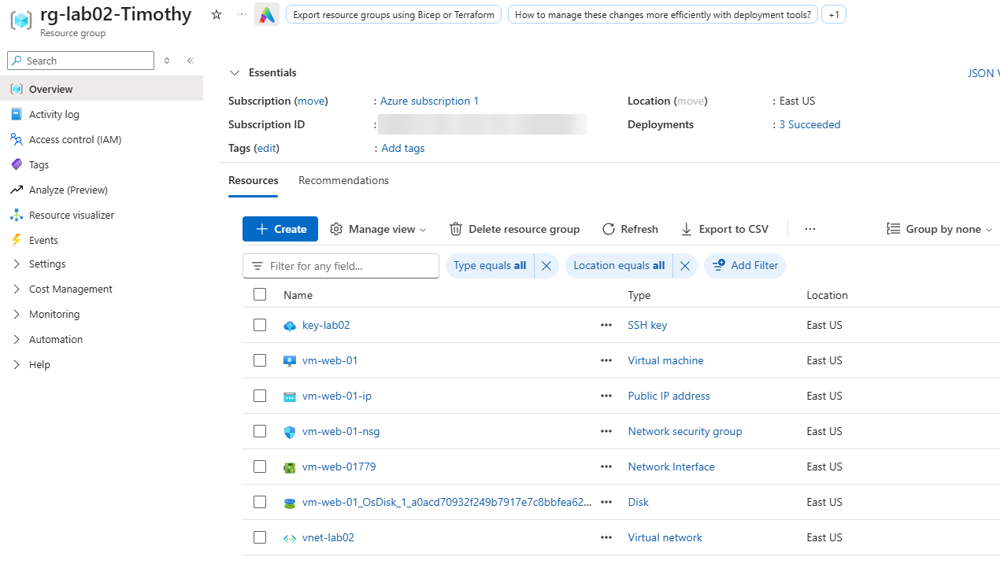

The resource group now holds 7 resources, all belonging to the web server and its network: the VM, its SSH key, public IP, network security group, network interface, disk, and the virtual network. Nothing from the database server is left.

### 2. Create the Azure SQL Database

In a new resource group, I created a logical SQL server and a single database on it. In Azure, the "server" is not a machine I manage. It is a container that holds the admin login and the firewall rules, and the database lives inside it.

For this lab the server uses a public endpoint protected by its firewall.

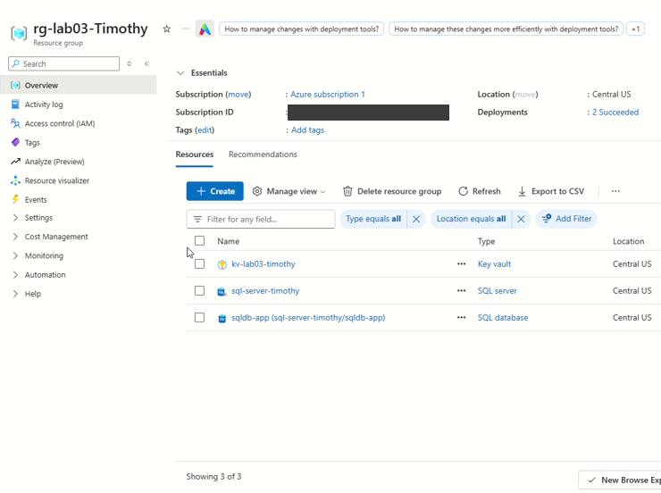

The new resource group holds 3 resources: the Key Vault, the SQL server, and the `sqldb-app` database.

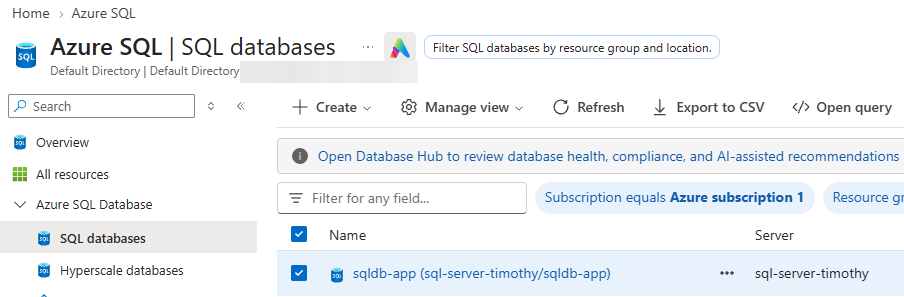

The SQL databases list confirms the database `sqldb-app` sits on the server `sql-server-timothy`.

### 3. Create the Key Vault and give myself access

I created the vault with the Azure role-based access control permission model. With that model, creating a vault does not let you work with the secrets inside it. My account already had the Owner role on the subscription, but Owner manages resources and does not include reading or writing secrets. I assigned my account the Key Vault Administrator role on the vault before I could add a secret.

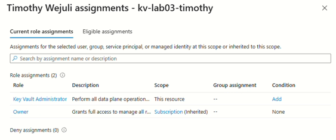

The screenshot shows both roles on my account: Key Vault Administrator scoped to this vault, and Owner inherited from the subscription.

### 4. Store the database password as a secret

I added the SQL admin password to the vault as a secret named `SqlAdminPassword`.

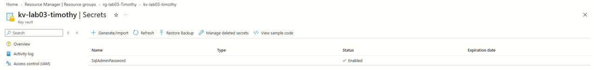

The secret is Enabled. The portal lists the name and status only, and the value stays hidden.

### 5. Give the web server an identity

On `vm-web-01`, I turned on the system-assigned managed identity. This registers the VM in Microsoft Entra ID so it can prove who it is to other Azure services. Azure manages the credential behind it, so there is nothing for me to store or rotate. The identity is tied to the VM and is removed if the VM is deleted.

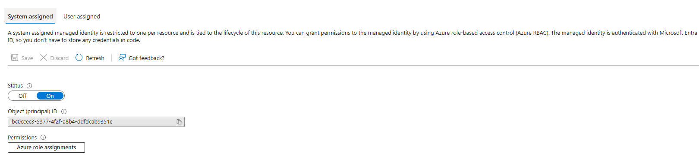

Status is On, and the VM now has its own Object (principal) ID.

### 6. Grant the identity read-only access to secrets

An identity has no access until it is given a role. On the Key Vault, I assigned the VM's identity the Key Vault Secrets User role. That role can read secret values. It cannot create, change, or delete them.

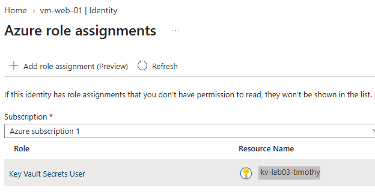

The VM's only role assignment is Key Vault Secrets User, and it applies to this one vault.

### 7. Test it from the web server

I connected to `vm-web-01` over SSH and ran four tests. The token and secret requests follow [Microsoft's managed identity tutorial for Linux VMs](https://learn.microsoft.com/en-us/entra/identity/managed-identities-azure-resources/tutorial-linux-managed-identities-vm-access), adjusted so the token and the password are never printed to the screen.

**Test 1: Does the VM have a working identity?** The VM asks Azure's built-in metadata service for a token and prints only the token's length.

```bash
TOKEN=$(curl -s 'http://169.254.169.254/metadata/identity/oauth2/token?api-version=2018-02-01&resource=https%3A%2F%2Fvault.azure.net' -H Metadata:true | grep -o '"access_token":"[^"]*"' | cut -d'"' -f4); echo "Token length: ${#TOKEN}"
```

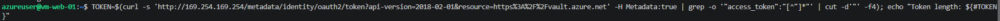

This screenshot shows the command. The result, `Token length: 1894`, is on screen in the [video walkthrough at 3:35](https://www.loom.com/share/b808c626ccc44ec2b4497085ea4515ab?t=215). A length of 0 would have meant the identity was off.

**Test 2: Can the VM read the secret?** The VM requests the secret with that token and prints only the status code.

```bash
read -p "Key Vault name: " VAULT
curl -s -o /dev/null -w "%{http_code}\n" "https://$VAULT.vault.azure.net/secrets/SqlAdminPassword?api-version=2016-10-01" -H "Authorization: Bearer $TOKEN"
```

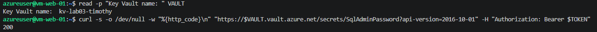

The request returned 200, which means success. The VM read the secret using only its identity.

**Test 3: Is the VM blocked from writing?** The VM tries to create a new secret.

```bash
curl -s -o /dev/null -w "%{http_code}\n" -X PUT "https://$VAULT.vault.azure.net/secrets/TestWrite?api-version=2016-10-01" -H "Authorization: Bearer $TOKEN" -H "Content-Type: application/json" -d '{"value":"test"}'
```

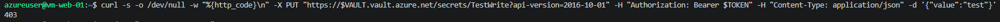

The request returned 403, which means denied. The VM can read secrets but cannot create them.

**Test 4: Can the VM reach the database?** The VM tries to open a connection to the SQL server on port 1433, the port SQL Server listens on.

```bash
read -p "SQL server name: " SQLSERVER
timeout 5 bash -c "</dev/tcp/$SQLSERVER.database.windows.net/1433" && echo "Port 1433 reachable" || echo "Port 1433 not reachable"
```

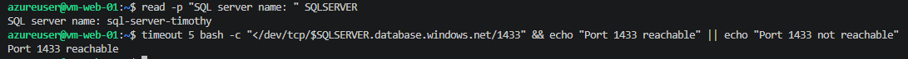

The port is reachable, so the web server can open a network connection to the SQL server. This test does not log in to the database, so it does not show whether the server's firewall rules accept the web server or whether the password works. Azure SQL reports a blocked address as an error at login.

| Test | Result | What it means |
|---|---|---|
| 1. Get a token | Token length: 1894 | Azure issued the VM a token, so the managed identity works |
| 2. Read `SqlAdminPassword` | 200 | Success. The VM read the secret using only its identity |
| 3. Create a new secret | 403 | Denied. The VM is read-only, which is what the role is supposed to allow |
| 4. Reach the SQL server on port 1433 | Port 1433 reachable | The web server can open a connection to the SQL server. A database login was not tested, so the firewall rules and the password are unconfirmed |

No password was typed or stored on the web server for any of these tests.

## Troubleshooting

Problems I ran into and how I fixed them.

| Problem | Cause | Fix |
|---|---|---|
| SSH failed with `Identity file key-lab02.pem not accessible: No such file or directory`, then `Permission denied (publickey)` | I ran the `ssh` command from a folder that did not contain the key file, so SSH had no key to send | Changed to the folder where the key was saved (Downloads) and ran the same command again |
| The secret read test did not return 200 the first time | I mistyped the Key Vault name at the prompt, so the request went to an address that does not exist | Ran the test again with the exact vault name, `kv-lab03-timothy`, and got 200 |

## What I Learned

- **Creating a vault is not the same as having access to its contents.** With the role-based access model, even a subscription Owner needs a separate Key Vault role to read or write secrets.
- **A managed identity is only half the setup.** Turning the identity on gives the VM a way to prove who it is. It still has no access until a role is assigned.
- **Test the "no" as well as the "yes".** The 200 showed the VM can read the secret. The 403 showed it cannot do more than that, which is the part that proves least privilege.
- **SSH looks for the key where you are.** A key file name only works if you are in the folder that holds it. Otherwise SSH needs the full path.

## What I Would Change for Production

- Use a private endpoint for the database and the Key Vault instead of public endpoints
- Use Microsoft Entra authentication for the database instead of a shared SQL admin password
- Set an expiration date on the secret and rotate it on a schedule
- Keep the web server and the database in the same region

## Next Steps

- Have the web server log in to the database using the password it reads from Key Vault, which would prove the full chain end to end
- Add an alert on the database's usage metric
- Rebuild the lab with Terraform

## Skills Demonstrated

- Azure SQL Database: creating a logical server and a single database
- Azure Key Vault: storing a secret in a vault that uses role-based access control
- Azure RBAC: assigning roles to a user and to a managed identity at the scope of one resource
- Managed identities: enabling a system-assigned identity on a Linux VM
- Least privilege: verifying both the allowed and the denied action
- Linux and SSH: connecting with key-based authentication and running tests with `curl` and a port check
- Reading HTTP status codes (200, 403) to confirm access results

## Cleanup

Run these when you are finished with the lab, to stop charges:

1. Delete the `rg-lab03-Timothy` resource group. This removes the SQL server, the database, and the Key Vault.
2. If the Key Vault name is needed again soon, purge the deleted vault under Key vaults > Manage deleted vaults. Soft-delete otherwise holds the name for its retention period.
3. Delete `rg-lab02-Timothy` as well if the web server is no longer needed for a follow-up lab.
